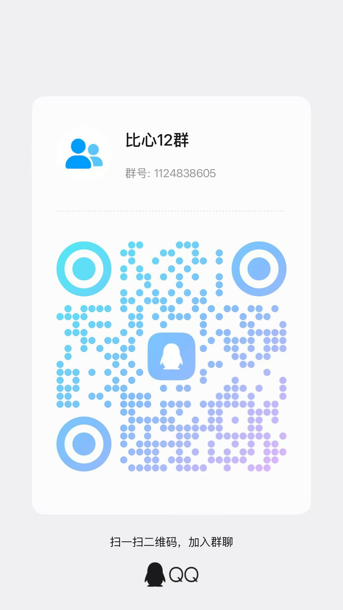
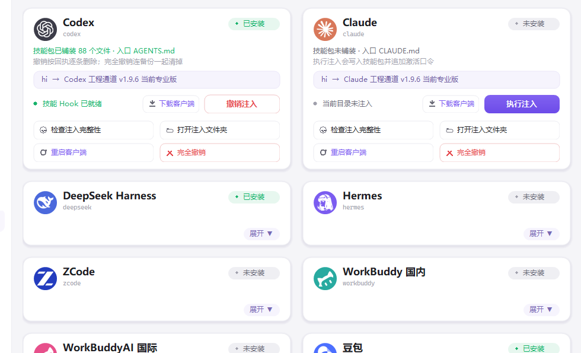
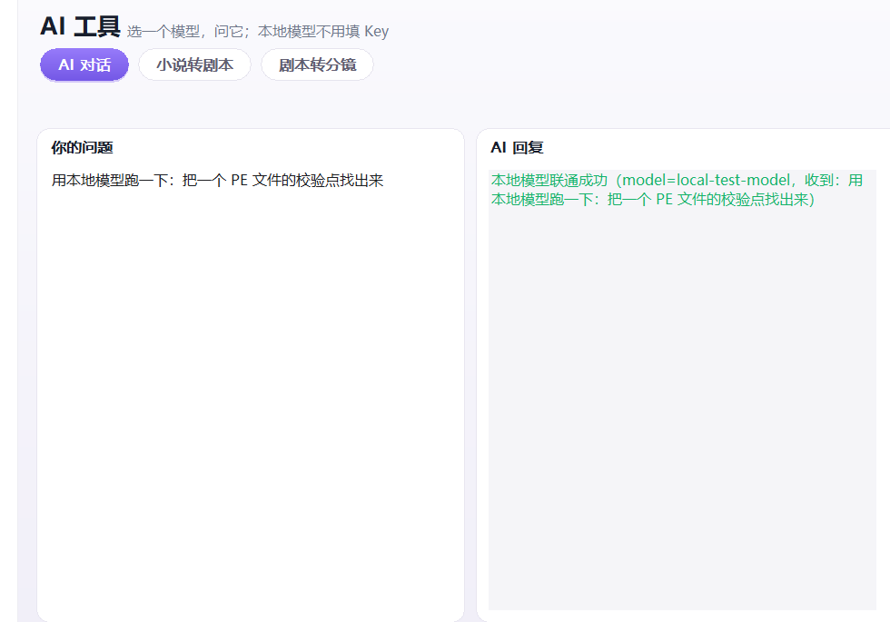
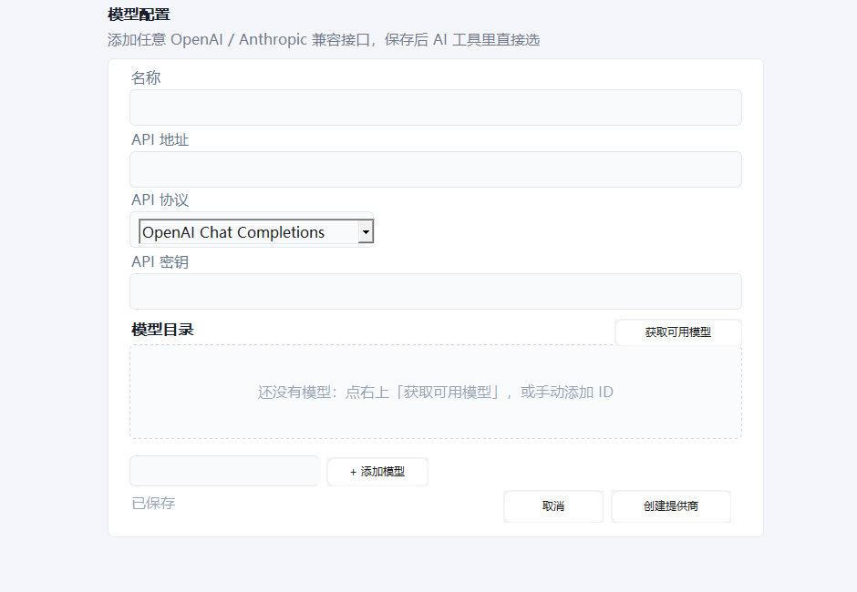
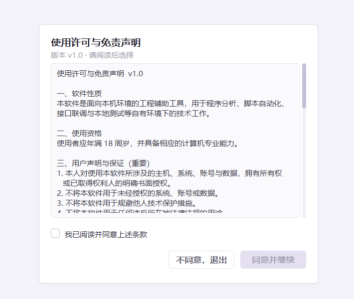
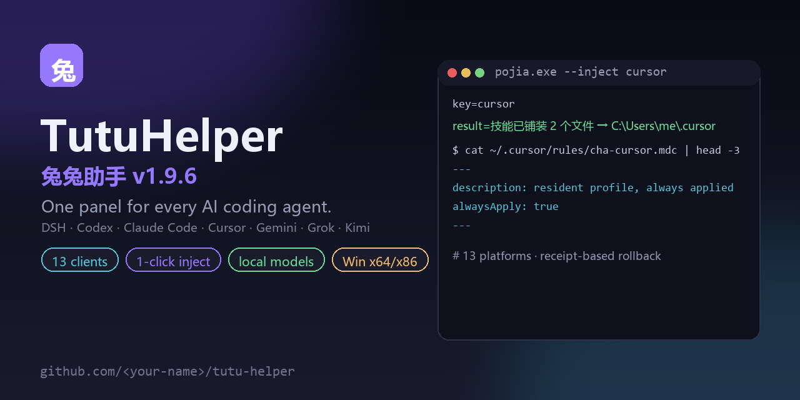

# 兔兔助手

一个面板管 13 个 AI 编程客户端：Codex、Claude Code、Cursor、DeepSeek Harness、Gemini、Grok、GLM、Kimi、ZCode、MiMo、WorkBuddy、豆包。常驻规则、技能包、本地模型一键搞定，持续更新。

可用领域：
破解（许可证、激活、卡密、注册机、反调试、壳/保护、密码学、VM） - 逆向（二进制、APK、iOS/macOS、内核、漏洞利用、协议、取证） - 游戏（客户端、内存、指针链、Hook、注入、驱动、反作弊、引擎、协议） - 渗透（Web/API、认证授权 JWT/OAuth/SAML、越权/IDOR、注入 SQLi/NoSQL/命令/SSTI/XXE/反序列化、文件上传/路径穿越、业务逻辑/竞态、AD/内网、提权、云/K8s/容器、隧道、AI/区块链）

获取最新版加 Q 群

1124838605

